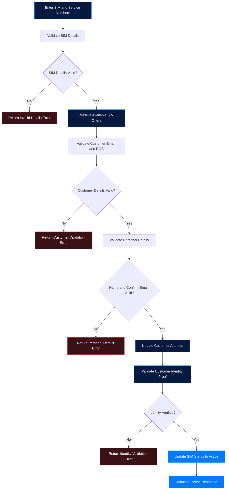

<div align="center">


<br/>


<br/>

[](https://github.com/Saheera-006)

</div>


## About the Project

The **SIM Activation Portal** is a backend application developed as part of the **Naan Mudhalvan / Infosys Springboard project**. It aims to automate the SIM activation process by validating SIM details, verifying customer information, checking identity proofs, and updating SIM activation status.

The application uses Java and Spring Boot to develop RESTful web services, MySQL to store and manage application data, and SoapUI to test API functionality, validation rules, and error-handling scenarios.

## Project Objectives

- Automate the SIM activation workflow.
- Validate SIM numbers and service numbers.
- Retrieve available offers for valid SIM details.
- Verify customer email addresses and dates of birth.
- Validate customer personal information.
- Update customer communication addresses.
- Verify identity proof details before activation.
- Activate eligible SIMs after successful verification.
- Handle invalid requests with meaningful error messages.

## Features

<table>
<tr>
<td width="50%" valign="top">

### SIM Validation

- Validate 13-digit SIM numbers.
- Validate 10-digit service numbers.
- Verify SIM and service number combinations.
- Detect already activated SIMs.
- Retrieve associated SIM offers.

</td>
<td width="50%" valign="top">

### Customer Verification

- Validate email and date of birth.
- Verify first name and last name.
- Compare confirm email with stored customer email.
- Validate customer information against database records.

</td>
</tr>
<tr>
<td width="50%" valign="top">

### Address Management

- Update customer communication addresses.
- Validate address length.
- Validate six-digit PIN codes.
- Restrict invalid characters in city and state fields.

</td>
<td width="50%" valign="top">

### Identity Verification

- Validate 16-digit Aadhaar identification numbers as specified in the project requirements.
- Verify names against stored identity records.
- Match date of birth.
- Activate the SIM after successful identity verification.

</td>
</tr>
</table>

## Technology Stack

<div align="center">


</div>

| Technology | Purpose |
|---|---|
| Java 17 | Backend programming language |
| Spring Boot 3.2.5 | Backend application development |
| Spring Web | REST API development |
| Spring Data JPA / Hibernate | Database persistence and ORM |
| MySQL 8 | Relational database |
| Maven | Dependency management and build automation |
| SoapUI | REST API testing |
| Spring Tool Suite (STS) | Development environment |
| Git and GitHub | Version control and source code management |

## Application Workflow

The application follows a step-by-step verification process before activating a SIM.



> Note: This diagram represents the overall business workflow. The exact request sequence depends on the REST endpoints and implementation in the application.

## Database Design

The application uses the `SimPortal` MySQL database to store SIM information, offers, customer details, addresses, and identity records.

### Database Tables

| Table | Description |
|---|---|
| `SimDetails` | Stores SIM number, service number, and activation status |
| `SimOffers` | Stores call quantity, data quantity, cost, duration, and offer name |
| `Customer` | Stores customer information and associated SIM details |
| `CustomerAddress` | Stores customer communication addresses |
| `CustomerIdentity` | Stores identity information for verification |

### Sample SIM Details

| simId | serviceNumber | simNumber | simStatus |
|---:|---|---|---|
| 1 | 1234567891 | 1234567891234 | active |
| 2 | 1234567892 | 1234567891235 | inactive |

The sample values above are illustrative records from the project specification.

### Database Setup

Create the database using MySQL:

```sql
CREATE DATABASE SimPortal;
```

The application may create the tables automatically if Hibernate/JPA schema generation is configured. Verify the entity mappings and database configuration before running the application.

## REST API Functionalities

The backend provides REST services for the following operations.

| Functionality | HTTP Method | Description |
|---|---|---|
| SIM validation | POST | Validates SIM and service number combination and retrieves offers |
| Customer basic validation | POST | Verifies customer email and date of birth |
| Customer personal validation | POST | Validates customer name and confirm email |
| Customer address update | PUT | Updates or adds customer address details |
| Customer identity validation | POST | Validates identity details and updates SIM activation status |

The exact endpoint URLs, request bodies, response formats, and status codes depend on the implemented controller mappings and DTOs.

## Validation and Error Handling

The application requirements specify validation rules for the following cases.

| Validation | Expected behaviour |
|---|---|
| Invalid SIM or service number | Return an appropriate invalid-details message |
| Already activated SIM | Return `SIM already active` |
| Missing email or DOB | Return `Email/dob value is required` |
| Invalid email format | Return `Invalid email` |
| No matching customer basic details | Return `No request placed for you.` |
| Invalid first name or last name length | Return the specified name validation error |
| Customer name not found | Return `No customer found for the provided details` |
| Email mismatch | Return `Invalid email details!!` |
| Address exceeds allowed length | Return an address validation error |
| Invalid PIN code | Return `Pin should be 6 digit number` |
| Invalid city or state characters | Return a city/state validation error |
| Invalid identity number | Return `Id should be 16 digit` |
| Invalid identity details | Return `Invalid details` |
| Incorrect date of birth | Return `Incorrect date of birth details` |

These messages describe the project acceptance criteria. The actual response must be verified against the implemented API behaviour.

## API Testing with SoapUI

**SoapUI** is used to send HTTP requests to the REST APIs and verify their responses.

### Testing Scenarios

- Valid and invalid SIM/service number combinations.
- SIMs that are already active.
- Missing or incorrectly formatted customer details.
- Valid and invalid email/date-of-birth combinations.
- Matching and non-matching customer names.
- Confirm-email mismatch scenarios.
- Valid and invalid address and PIN code values.
- Invalid city and state inputs.
- Matching and non-matching identity proof details.
- Successful SIM activation and database status verification.

### Testing Process

1. Start the Spring Boot application.
2. Open SoapUI and create a REST project.
3. Enter the endpoint URL configured in the application.
4. Select the required HTTP method.
5. Provide the request parameters or JSON body.
6. Send the request and inspect the response.
7. Test both valid and invalid input scenarios.
8. Verify database updates for address changes and SIM activation.

Testing both positive and negative scenarios helps verify the business rules, input validation, and exception-handling behaviour.

## Getting Started

### Prerequisites

Install the following tools:

- [Java JDK 17](https://adoptium.net/)
- [Spring Tool Suite](https://spring.io/tools)
- [MySQL Community Server](https://dev.mysql.com/downloads/installer/)
- [SoapUI](https://www.soapui.org/downloads/latest-release.html)
- [Git](https://git-scm.com/)

### 1. Clone the Repository

```bash
git clone https://github.com/Saheera-006/YOUR-REPOSITORY.git
cd YOUR-REPOSITORY
```

Replace `YOUR-REPOSITORY` with your actual GitHub repository name.

### 2. Configure MySQL

Start your MySQL server and create the database:

```sql
CREATE DATABASE SimPortal;
```

### 3. Configure Application Properties

Open `src/main/resources/application.properties` and configure the database connection.

Example configuration:

```properties
spring.datasource.url=jdbc:mysql://localhost:3306/SimPortal
spring.datasource.username=${DB_USERNAME}
spring.datasource.password=${DB_PASSWORD}

spring.jpa.hibernate.ddl-auto=update
spring.jpa.show-sql=true
```

Set the `DB_USERNAME` and `DB_PASSWORD` environment variables for your local environment.

**Security note:** Never commit actual passwords, API keys, or private credentials to GitHub.

Use the schema-generation strategy appropriate for the project. If the database tables are managed manually, configure Hibernate accordingly.

### 4. Run the Application

From the project root, run:

```bash
mvn spring-boot:run
```

If the project includes the Maven Wrapper on Windows, you can also use:

```bash
mvnw.cmd spring-boot:run
```

Alternatively, import the project into Spring Tool Suite and run the main Spring Boot application class.

By default, Spring Boot applications run at:

```text
http://localhost:8080
```

The application must be running before API requests can be tested.

### 5. Test the Endpoints

Use SoapUI to send requests to the endpoint URLs defined by the application's controllers.

Verify the response messages and check the MySQL database to confirm that address updates and SIM activation status changes are persisted correctly.

## Learning Outcomes

Through this project, I explored:

- Developing RESTful APIs using Java and Spring Boot.
- Connecting backend applications to MySQL.
- Managing database entities and relationships using JPA/Hibernate.
- Implementing business rules and input validation.
- Handling invalid requests with custom error messages.
- Testing REST services using SoapUI.
- Verifying API behaviour through positive and negative test cases.
- Understanding a backend application workflow from validation to activation.

## Future Enhancements

- Add authentication and authorization.
- Improve REST API documentation with Swagger/OpenAPI.
- Expand automated unit and integration testing.
- Introduce structured logging and monitoring.
- Improve sensitive-data protection and security practices.
- Add a frontend interface for customer interactions.

## Developer

<div align="center">

**Fathima Saheera J**

Aspiring Full Stack Developer

[](https://github.com/Saheera-006)

</div>

---

<div align="center">

**Built with Java. Powered by Spring Boot. Tested with SoapUI.** 💙


</div>
