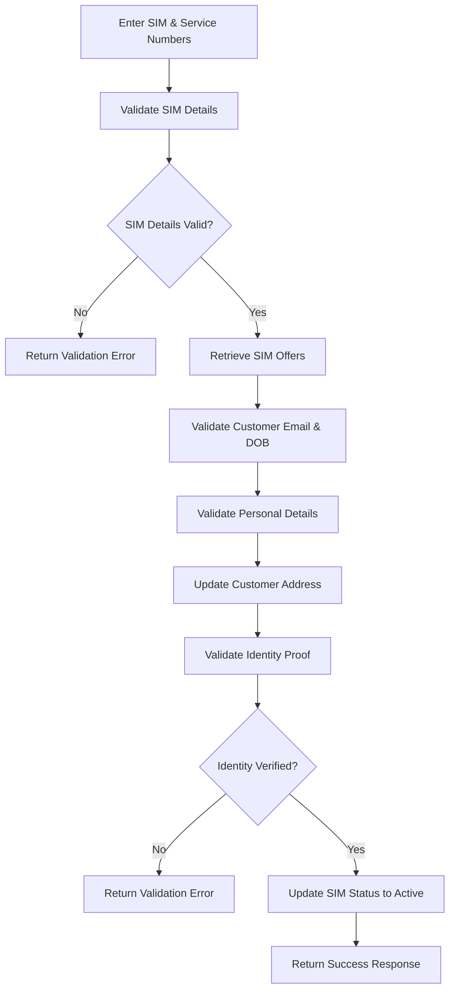

 <div align="center">


<br/>


</div>


## About the Project

The **SIM Activation Portal** is a backend application developed as part of the **Naan Mudhalvan / Infosys Springboard project**. It aims to automate the SIM activation process by validating SIM details, verifying customer information, checking identity proofs, and updating SIM activation status.

The application exposes RESTful web services built with Java and Spring Boot, uses MySQL for data persistence, and is tested using SoapUI to validate API responses, business rules, and error-handling scenarios.

## Objectives

- Automate the SIM activation workflow.
- Validate SIM and service number combinations.
- Verify customer information against stored records.
- Validate identity proof details before activation.
- Maintain customer address information.
- Provide meaningful validation errors for invalid requests.
- Test REST APIs across positive and negative use cases.

## Key Features

<table>
<tr>
<td width="50%" valign="top">

### SIM Validation

- Validate 13-digit SIM numbers.
- Validate 10-digit service numbers.
- Check SIM and service number combinations.
- Detect already activated SIMs.
- Retrieve applicable SIM offers.

</td>
<td width="50%" valign="top">

### Customer Verification

- Validate email and date of birth.
- Verify first name and last name.
- Confirm email against stored customer details.
- Validate customer information against database records.

</td>
</tr>
<tr>
<td width="50%" valign="top">

### Address Management

- Update customer communication addresses.
- Validate address length.
- Verify six-digit PIN codes.
- Validate city and state inputs.

</td>
<td width="50%" valign="top">

### Identity Verification

- Validate 16-digit Aadhaar identification numbers.
- Match identity details against stored records.
- Verify names and date of birth.
- Activate eligible SIMs after successful verification.

</td>
</tr>
</table>

## Technology Stack

<div align="center">


</div>

| Technology | Purpose |
|---|---|
| Java 17 | Backend programming |
| Spring Boot 3.2.5 | REST API development |
| Spring Web | HTTP request handling and REST endpoints |
| Spring Data JPA / Hibernate | Database persistence and ORM |
| MySQL 8 | Relational database |
| Maven | Dependency management and build automation |
| SoapUI | REST API testing and validation |
| Git & GitHub | Version control and source code management |

## Application Workflow



## Database Design

The application uses the `SimPortal` MySQL schema to store SIM, offer, customer, address, and identity information.

| Table | Description |
|---|---|
| `SimDetails` | Stores SIM numbers, service numbers, and activation status |
| `SimOffers` | Stores available call, data, cost, and duration details |
| `Customer` | Stores customer information and associated SIM details |
| `CustomerAddress` | Stores customer communication addresses |
| `CustomerIdentity` | Stores identity verification information |

### Sample Data

**SimDetails**

| simId | serviceNumber | simNumber | simStatus |
|---:|---|---|---|
| 1 | 1234567891 | 1234567891234 | active |
| 2 | 1234567892 | 1234567891235 | inactive |

*These are sample values from the project specification. Use appropriate test data in your own environment.*

## REST API Functionalities

The backend provides REST endpoints for the following operations.

| Operation | HTTP method | Purpose |
|---|---|---|
| SIM validation and offer retrieval | POST | Validate SIM and service numbers and retrieve offers |
| Customer basic validation | POST | Verify email address and date of birth |
| Customer personal validation | POST | Validate customer name and confirm email |
| Customer address update | PUT | Validate and update address information |
| Customer identity validation and activation | POST | Verify identity details and activate the SIM |

The exact endpoint URLs and request/response structures are defined by the application's controller mappings and DTOs.

## Validation and Error Handling

The application requirements include validation for:

- SIM and service number formats.
- Mandatory customer details.
- Email and date-of-birth formats.
- First-name and last-name constraints.
- Address length and PIN code format.
- City and state input restrictions.
- Identity number, name, and date-of-birth matching.
- Already activated SIMs and invalid customer records.

Custom error responses help identify invalid input and unsuccessful verification scenarios.

## API Testing with SoapUI

SoapUI is used to send HTTP requests to the Spring Boot REST services and inspect their responses.

Testing scenarios include:

- Valid and invalid SIM/service number combinations.
- Already activated SIMs.
- Missing or invalid customer details.
- Matching and non-matching email and date-of-birth values.
- Customer name and confirm-email mismatches.
- Invalid address and PIN code inputs.
- Valid and invalid identity proof details.
- Successful activation and activation-status verification.

Both positive and negative test cases help verify the API's behaviour against the project acceptance criteria.

## Getting Started

### Prerequisites

Install the following software:

- [Java JDK 17](https://adoptium.net/)
- [Spring Tool Suite](https://spring.io/tools)
- [MySQL Community Server](https://dev.mysql.com/downloads/installer/)
- [SoapUI](https://www.soapui.org/downloads/latest-release.html)
- Git

### 1. Clone the Repository

```bash
git clone https://github.com/Saheera-006/YOUR-REPOSITORY.git
cd YOUR-REPOSITORY
```

Replace `YOUR-REPOSITORY` with the actual GitHub repository name.

### 2. Create the Database

Open MySQL Workbench or your MySQL command-line client and execute:

```sql
CREATE DATABASE SimPortal;
```

Ensure that your MySQL server is running before starting the application.

### 3. Configure Database Connectivity

Update `src/main/resources/application.properties` with your local database configuration. For example:

```properties
spring.datasource.url=jdbc:mysql://localhost:3306/SimPortal
spring.datasource.username=${DB_USERNAME}
spring.datasource.password=${DB_PASSWORD}

spring.jpa.hibernate.ddl-auto=update
spring.jpa.show-sql=true
```

Set `DB_USERNAME` and `DB_PASSWORD` in your environment, or use local-only configuration appropriate for your setup. Never commit actual database passwords or other secrets to GitHub.

Use the schema-generation setting appropriate for your existing database and project configuration. If Hibernate creates the tables automatically, verify that the resulting schema matches your entity mappings.

### 4. Run the Application

From the project root, run:

```bash
mvn spring-boot:run
```

Alternatively, open the project in Spring Tool Suite and run the main Spring Boot application class.

The default local server address is:

```text
http://localhost:8080
```

The application must be running before you send requests from SoapUI.

### 5. Test the REST APIs

1. Open SoapUI and create a REST project.
2. Enter the endpoint URL from the application's controller mappings.
3. Select the appropriate HTTP method.
4. Provide the request body in the format expected by the endpoint.
5. Send the request and inspect the response status, response body, and validation messages.
6. Verify database changes after address updates and successful SIM activation.

## Learning Outcomes

Through this project, I explored:

- Building RESTful services using Java and Spring Boot.
- Working with relational databases and JPA entities.
- Implementing input validation and custom error handling.
- Connecting backend services to MySQL.
- Testing API behaviour with SoapUI.
- Verifying business rules through positive and negative test cases.

## Future Enhancements

- Add authentication and authorization.
- Improve API documentation with OpenAPI/Swagger.
- Expand automated integration and unit testing.
- Introduce structured logging and monitoring.
- Improve security and sensitive-data handling.

## Developer

<div align="center">

**Fathima Saheera J**

Aspiring Full Stack Developer

[](https://github.com/Saheera-006)

</div>

---

<div align="center">

**Built with Java. Powered by Spring Boot. Tested with SoapUI.** 💙


</div>